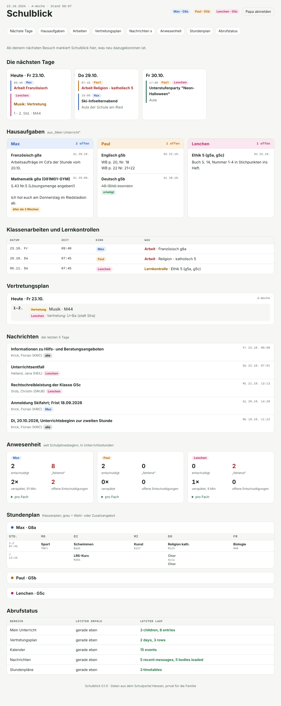
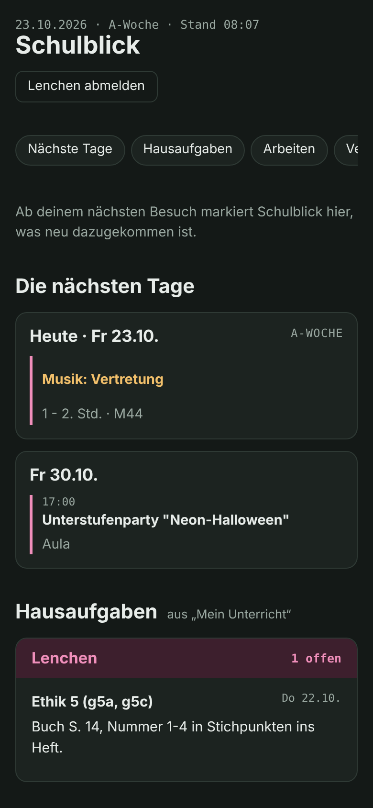
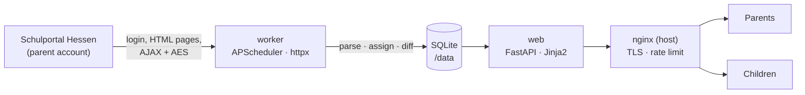

# Schulblick

**A private family dashboard for Schulportal Hessen.**
Schulblick logs in with a parent account, collects everything that matters for each child — homework, exams,
substitutions, school calendar, timetables, attendance and recent messages — and shows every family member a
clean, mobile-friendly overview. Parents see all children; each child sees only their own items, in the same layout.

> Unofficial. Not affiliated with the Hessian Ministry of Education or Schulportal Hessen. Built for private use by
> one family with its own credentials. Use moderate polling and respect your school's rules.

<p align="center">
  
  &nbsp;
  
</p>
<p align="center"><sub>Parent view (desktop) and child view (phone, dark mode). Screenshots use anonymised test data.</sub></p>

---

## Contents

- [Features](#features)
- [How it works](#how-it-works)
- [Who sees what](#who-sees-what)
- [Project layout](#project-layout)
- [Configuration](#configuration)
- [Deployment](#deployment)
- [Operations](#operations)
- [Development](#development)
- [Security and privacy](#security-and-privacy)
- [Known limitations](#known-limitations)
- [Roadmap](#roadmap)
- [Acknowledgements](#acknowledgements)

## Features

| Section | Source in the portal | Notes |
|---|---|---|
| **Next days** | calendar, substitution plan, exams | One card per day for the next 7 days, colour-coded per child |
| **Homework** | *Mein Unterricht* → current entries | Open/done status, flags homework older than three weeks |
| **Exams and tests** | calendar (*Klausurplaner*) | Matched to children via the course group, 10-week horizon |
| **Substitution plan** | *Vertretungsplan* | Only rows for your children's classes; "falls belegt" when the course choice is unknown |
| **Messages** | *Nachrichten* (encrypted) | Last 5 days, with body text, assigned by recipient groups |
| **Attendance** | *Mein Unterricht* → attendance | Excused, missing, late (count and minutes), open excuses |
| **Timetable** | *Stundenplan* | Class timetable; religion/ethics choice resolved from the child's courses |
| **What's new** | all of the above | Items added or changed since the user's last visit are marked *neu* |
| **Sync status** | — | Parents see when each area was last fetched and any errors |

The UI is German, works on phones (installable to the home screen), supports light and dark mode and needs no
external fonts or scripts.

## How it works



Two containers share one SQLite volume:

* **worker** logs in to the portal, fetches each area on a schedule, parses the pages, maps every item to the
  children it concerns and stores it with `first_seen` / `changed_at` timestamps. It is the only component that
  holds the portal credentials.
* **web** serves the login and the overview. It never talks to the portal.

**Schedule** (Europe/Berlin): school days 06:15–16:45 every 30 minutes; 19:00 and 21:00 before school days;
weekends 08:05 and 18:05; calendar daily at 05:30; timetables Sundays; database backup nightly at 03:30.

**Portal protocol.** Login runs `login.schulportal.hessen.de` → `connect.schulportal.hessen.de` → `start.schulportal.hessen.de`
(session cookie `sid`), re-login every 15 minutes or when the session expires. Messages are encrypted: the client
sends a random key wrapped with the portal's RSA public key, verifies the challenge, then decrypts AES-256-CBC
payloads in OpenSSL "Salted__" format. Loading a message body marks it as read in the portal.

## Who sees what

Every item carries the list of children it concerns. The rules live in [`src/schulblick/sync/assign.py`](src/schulblick/sync/assign.py):

* **Exams/tests** — the calendar entry names a course group (`Französisch g8a (081F01-GYM)`), matched against the
  courses each child has in *Mein Unterricht*.
* **Other school events** — audiences are parsed from the text (`JG5-7`, `G9+R9`, `5. und 6. Klassen`, `Unterstufe`,
  `Q1`…). No audience means the whole family. Events containing a keyword from `parent_only_keywords`
  (e.g. *Elternabend*) are hidden from children.
* **Substitutions** — rows that list the child's class. "Sure" when the subject is in that slot of the child's
  timetable, otherwise shown as "falls belegt" (if taken).
* **Messages** — groups addressed to *Eltern …* are parents-only; *Lernende / SuS* groups are also shown to the
  matching children; messages sent personally to the parents stay with the parents.

Access control is applied when the overview is built (`OverviewBuilder`), not only in templates.
Tests assert that a child never sees another child's data.

## Project layout

```
.
├── config/family.toml          # school, children, accounts, display rules (no secrets)
├── deploy/
│   ├── ANLEITUNG.md            # step-by-step server setup (German)
│   ├── setup.sh                # first-time setup on the server
│   ├── update.sh               # rebuild + restart after an update
│   └── nginx/                  # vhost, proxy snippet, rate limit, bootstrap vhost for certbot
├── docker-compose.yml          # web (127.0.0.1:8130) + worker, read-only containers
├── Dockerfile
├── docs/                       # screenshots
├── src/schulblick/
│   ├── sph/
│   │   ├── client.py           # login flow, session renewal, page and AJAX fetches
│   │   ├── cryptor.py          # RSA handshake, AES "Salted__" encrypt/decrypt
│   │   └── parsers.py          # pure parsers for all parent views
│   ├── sync/
│   │   ├── assign.py           # which child does an item belong to, who may see it
│   │   ├── runner.py           # one sync pass per area with change detection
│   │   └── worker.py           # schedule, credential blocking, backups, housekeeping
│   ├── web/
│   │   ├── app.py              # FastAPI app, security headers, origin check
│   │   ├── auth.py             # argon2 passwords, sessions, throttling, optional TOTP
│   │   ├── views.py            # builds the overview for one user
│   │   ├── templates/          # Jinja2 templates
│   │   └── static/             # CSS, icons, web manifest
│   ├── cli.py                  # admin commands (passwords, sync, check-login)
│   ├── config.py
│   ├── db.py                   # SQLite schema and helpers
│   └── fixtures.py             # offline client that reads saved pages
└── tests/                      # pytest suite + anonymised portal fixtures
```

## Configuration

Everything family-specific lives in [`config/family.toml`](config/family.toml). Credentials do **not** go there.

| Key | Default | Meaning |
|---|---|---|
| `school.id` | — | School number from the portal URL (`?i=6055`) |
| `portal.fetch_message_bodies` | `true` | Load message text (marks messages as read in the portal) |
| `portal.message_window_days` | `5` | How far back messages are shown |
| `display.upcoming_days` | `7` | Length of the "next days" strip |
| `display.exams_horizon_days` | `70` | How far ahead exams are listed |
| `display.homework_stale_days` | `21` | Open homework older than this gets a warning badge |
| `display.kids_see_attendance` | `true` | Children see their own attendance |
| `display.hidden_event_categories` | `["15","9"]` | Calendar categories ignored (conferences, Abitur) |
| `display.parent_only_keywords` | see file | Events with these words are parents-only |
| `security.require_totp_for_parents` | `false` | Require an authenticator code for parent accounts |
| `security.session_days` | `90` | How long a device stays logged in |
| `[[children]]` | — | `first_name` as in the portal, `display_name` for the UI; order defines the colour |
| `[[users]]` | — | `username`, `display_name`, `role` (`parent`/`child`), `child` for child accounts |

Environment variables (set in `docker-compose.yml`): `SCHULBLICK_CONFIG`, `SCHULBLICK_DB`, `SCHULBLICK_SPH_SECRET`,
`SCHULBLICK_COOKIE_SECURE`.

The portal credentials are a two-line file `secrets/sph_credentials`, mounted as a Docker secret into the worker only:

```
username=vorname.nachname
password=...
```

Use the username exactly as typed on the portal login page, **lower case and without the school number**.

## Deployment

Target: Ubuntu 24.04 with Docker Compose and nginx on the host (here: the Tangosummer server), public name
`family.verstehst.de`. Full German walkthrough: [`deploy/ANLEITUNG.md`](deploy/ANLEITUNG.md).

```bash
# 1. DNS: A record  family.verstehst.de → server IP
# 2. copy the project to /opt/schulblick, then:
cd /opt/schulblick
sudo bash deploy/setup.sh          # asks for the portal credentials, builds, starts, gets the certificate
# 3. accounts
sudo docker compose run --rm web schulblick set-password papa   # repeat for mama, ben, boje, lotte
```

Updates: pull/copy the new version, then `sudo bash deploy/update.sh`. Data and secrets survive.

## Operations

All commands run in `/opt/schulblick` with `sudo`.

| Task | Command |
|---|---|
| Show accounts | `docker compose run --rm web schulblick users` |
| Set / reset a password | `docker compose run --rm web schulblick set-password <name>` |
| Enable / remove TOTP | `docker compose run --rm web schulblick totp-setup <name>` / `totp-remove <name>` |
| Test the portal login | `docker compose run --rm worker schulblick check-login` |
| Sync now | `docker compose run --rm worker schulblick sync [lessons timetables substitutions calendar messages]` |
| Worker logs | `docker compose logs -f worker` |
| Last sync runs | `docker compose exec worker sqlite3 -column /data/schulblick.db "SELECT area, ok, message, finished_at FROM sync_runs ORDER BY id DESC LIMIT 6"` |
| Portal password changed | edit `secrets/sph_credentials`, then `docker compose restart worker` |

If the portal rejects the parent credentials, the worker stops trying (to avoid an account lock) until the secret
file changes; parents see a red notice in the app.

## Development

```bash
python -m venv .venv && . .venv/bin/activate
pip install -e .[dev]
pytest                                   # parsers, assignment, crypto, login flow, web access control

# local preview with anonymised fixtures, no portal access needed
export SCHULBLICK_CONFIG=tests/fixtures/family_test.toml SCHULBLICK_DB=/tmp/sb.db SCHULBLICK_COOKIE_SECURE=false
schulblick sync --fixtures tests/fixtures
schulblick set-password papa
uvicorn schulblick.web.app:create_app --factory --port 8765
```

Parsers are pure functions over HTML/JSON, so a portal change is fixed by saving the new page as an (anonymised)
fixture, adjusting the parser and adding a test.

## Security and privacy

* Portal credentials exist only in `secrets/sph_credentials` (uid 10001, mode 0400) and in the worker container.
  `secrets/` is git-ignored.
* Containers run as an unprivileged user with a read-only root filesystem, no capabilities and `no-new-privileges`;
  the web port is bound to `127.0.0.1` and published only through nginx with TLS.
* Passwords are hashed with argon2; sessions are random tokens stored hashed; login is throttled per user and per IP
  and additionally rate-limited in nginx. Optional TOTP for parents.
* Strict security headers (CSP without inline scripts, `frame-ancestors 'none'`, `noindex`), same-origin check on
  every POST.
* Data minimisation: messages are kept 30 days, inactive homework 60 days, substitutions 7 days; attendance only as
  the current totals. Nightly backups are kept for 7 days inside the data volume.
* `config/family.toml` contains first names and the school — keep this repository private.

## Known limitations

* The portal has no official API. Layout changes can break a parser; the sync status shows which area failed.
* Loading message bodies marks messages as read in the portal.
* For parent accounts the portal only exposes the class timetable, not the personal one; elective courses other
  than religion/ethics are shown greyed out.
* Assignment of general school events relies on wording such as "JG5-7"; unusual phrasing may need a rule.

## Roadmap

**Family calendar** (next): shared calendar in the same app.

* `family_events(id, title, start, end, all_day, location, note, audience, created_by, updated_at)`, where
  `audience` is a list of child ids, `["*"]` for everyone or `["parents"]`.
* Everyone can add entries. Children see their own and family-wide entries, parents see everything.
  Children edit only what they created; parents edit everything.
* School items (exams, holidays, substitutions) appear read-only in the same view.
* Per-person ICS feed (`/ics/<token>.ics`) for phone calendars.

Later: push notification for cancellations tomorrow or new messages; morning summary.

## Acknowledgements

The login flow and message encryption follow the community projects
[lanis-mobile / liblanis](https://github.com/lanis-mobile) and
[lanisapi](https://pypi.org/project/lanisapi/). Schulblick contains no code from them; they were the reference for
how the portal behaves.

---

Private project · no license granted.
