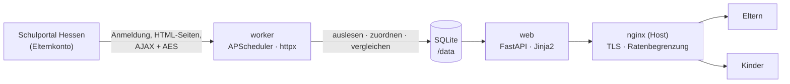
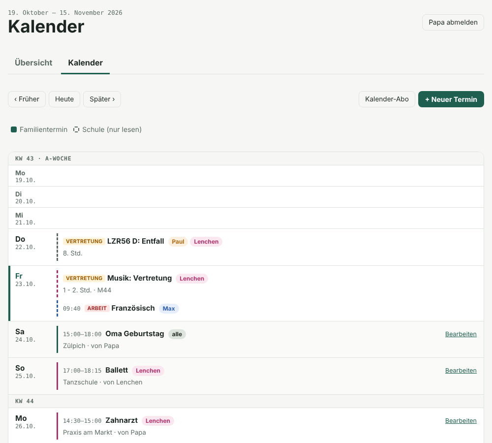

# Schulblick

**Ein privater Familienüberblick für das Schulportal Hessen.**
Schulblick meldet sich mit dem Elternkonto an und sammelt für jedes Kind alles Wichtige: Hausaufgaben,
Klassenarbeiten, Vertretungen, Schultermine, Stundenpläne, Anwesenheit und aktuelle Nachrichten. Jedes
Familienmitglied bekommt daraus eine übersichtliche Ansicht, die auch auf dem Handy gut funktioniert. Eltern sehen
alle Kinder, jedes Kind sieht nur seine eigenen Einträge, im gleichen Aufbau.

> Inoffiziell. Kein Angebot des Hessischen Kultusministeriums oder des Schulportals Hessen. Gebaut für die private
> Nutzung durch eine Familie mit ihren eigenen Zugangsdaten. Bitte zurückhaltend abfragen und die Regeln der Schule
> beachten.

<p align="center">
  
  &nbsp;
  
</p>
<p align="center"><sub>Elternansicht am Rechner und Kinderansicht auf dem Handy im Dunkelmodus. Die Screenshots zeigen anonymisierte Testdaten.</sub></p>

---

## Inhalt

- [Funktionen](#funktionen)
- [So funktioniert es](#so-funktioniert-es)
- [Wer sieht was](#wer-sieht-was)
- [Familienkalender](#familienkalender)
- [Aufbau des Projekts](#aufbau-des-projekts)
- [Konfiguration](#konfiguration)
- [Installation auf dem Server](#installation-auf-dem-server)
- [Betrieb](#betrieb)
- [Entwicklung](#entwicklung)
- [Sicherheit und Datenschutz](#sicherheit-und-datenschutz)
- [Bekannte Grenzen](#bekannte-grenzen)
- [Ausblick](#ausblick)
- [Dank](#dank)

## Funktionen

| Bereich | Quelle im Portal | Hinweise |
|---|---|---|
| **Die nächsten Tage** | Kalender, Vertretungsplan, Klassenarbeiten | Eine Karte pro Tag für die kommenden 7 Tage, farblich nach Kind |
| **Hausaufgaben** | *Mein Unterricht* → Aktuelle Einträge | Offen oder erledigt; Hinweis bei Aufgaben, die älter als drei Wochen sind |
| **Klassenarbeiten und Lernkontrollen** | Kalender (*Klausurplaner*) | Zuordnung zum Kind über die Lerngruppe, Vorschau über 10 Wochen |
| **Vertretungsplan** | *Vertretungsplan* | Nur Zeilen für die Klassen der Kinder; „falls belegt“, wenn die Kurswahl unklar ist |
| **Nachrichten** | *Nachrichten* (verschlüsselt) | Die letzten 5 Tage mit Text, zugeordnet über die Empfängergruppen |
| **Anwesenheit** | *Mein Unterricht* → Anwesenheiten | Entschuldigt, fehlend, verspätet (Anzahl und Minuten), offene Entschuldigungen |
| **Stundenplan** | *Stundenplan* | Klassenplan; Religion bzw. Ethik wird aus den Kursen des Kindes erkannt |
| **Neu seit dem letzten Besuch** | alle Bereiche | Neue oder geänderte Einträge sind mit *neu* markiert |
| **Abrufstatus** | – | Eltern sehen, wann jeder Bereich zuletzt abgerufen wurde und ob Fehler auftraten |
| **Familienkalender** | eigene Einträge + Schule | Gemeinsamer Kalender mit Rechten pro Person und ICS-Abo fürs Handy, siehe [unten](#familienkalender) |

Die Oberfläche funktioniert auf dem Handy und lässt sich zum Startbildschirm hinzufügen. Sie hat einen hellen und
einen dunklen Modus und lädt keine externen Schriften oder Skripte.

## So funktioniert es



Zwei Container teilen sich eine SQLite-Datenbank:

* **worker** meldet sich am Portal an, ruft die Bereiche nach Zeitplan ab, liest die Seiten aus, ordnet jeden
  Eintrag den betroffenen Kindern zu und speichert ihn mit den Zeitstempeln `first_seen` und `changed_at`. Nur
  dieser Container kennt die Zugangsdaten zum Portal.
* **web** liefert Anmeldung und Übersicht aus. Er spricht nie mit dem Portal.

**Zeitplan** (Europe/Berlin): an Schultagen 06:15–16:45 alle 30 Minuten; 19:00 und 21:00 vor Schultagen;
am Wochenende 08:05 und 18:05; Kalender täglich um 05:30; Stundenpläne sonntags; Datenbanksicherung jede Nacht um 03:30.

**Ablauf im Portal.** Die Anmeldung läuft über `login.schulportal.hessen.de` → `connect.schulportal.hessen.de` →
`start.schulportal.hessen.de` (Sitzungscookie `sid`). Nach 15 Minuten oder wenn die Sitzung abläuft, meldet sich
Schulblick neu an. Nachrichten sind verschlüsselt: Schulblick schickt einen zufälligen Schlüssel, verpackt mit dem
öffentlichen RSA-Schlüssel des Portals, prüft die Antwort und entschlüsselt dann die Inhalte (AES-256-CBC im
OpenSSL-Format „Salted__“). Wenn Schulblick den Text einer Nachricht lädt, gilt sie im Portal als gelesen.

## Wer sieht was

Jeder Eintrag trägt die Liste der Kinder, die er betrifft. Die Regeln stehen in
[`src/schulblick/sync/assign.py`](src/schulblick/sync/assign.py):

* **Klassenarbeiten und Lernkontrollen**: Der Kalendereintrag nennt eine Lerngruppe
  (`Französisch g8a (081F01-GYM)`). Sie wird mit den Kursen abgeglichen, die das Kind in *Mein Unterricht* hat.
* **Andere Schultermine**: Die Zielgruppe wird aus dem Text gelesen (`JG5-7`, `G9+R9`, `5. und 6. Klassen`,
  `Unterstufe`, `Q1` …). Ohne Angabe gilt der Termin für die ganze Familie. Termine mit einem Stichwort aus
  `parent_only_keywords` (z. B. *Elternabend*) sehen die Kinder nicht.
* **Vertretungen**: Zeilen, in denen die Klasse des Kindes steht. „Sicher“, wenn das Fach in dieser Stunde im
  Stundenplan des Kindes steht, sonst mit dem Hinweis „falls belegt“.
* **Nachrichten**: Gruppen wie *Eltern …* sehen nur die Eltern. Gruppen wie *Lernende* oder *SuS* sehen zusätzlich
  die passenden Kinder. Nachrichten, die persönlich an die Eltern gehen, bleiben bei den Eltern.

Die Rechte werden beim Zusammenstellen der Übersicht geprüft (`OverviewBuilder`), nicht erst in den Vorlagen.
Tests stellen sicher, dass kein Kind die Daten eines Geschwisters sieht.

## Familienkalender

Unter **Kalender** führt die Familie einen gemeinsamen Kalender. Er zeigt vier Wochen am Stück, Woche für Woche
mit A-/B-Woche, und mischt eigene Einträge mit den Schulterminen.

<p align="center">
  
</p>

* **Eintragen dürfen alle.** Ohne Uhrzeit ist ein Termin ganztägig; mit „bis Datum“ geht er über mehrere Tage.
  Ein Tipp auf ein Datum öffnet das Formular für diesen Tag.
* **Wiederkehrende Termine:** täglich, wöchentlich, alle 2 Wochen, monatlich oder jährlich, optional mit Enddatum.
  Mit „nicht in den Schulferien und an schulfreien Tagen“ fallen Termine wie das Training automatisch aus, wenn der
  Schulkalender Ferien, Feiertage oder unterrichtsfreie Tage meldet. Einzelne Termine einer Serie lassen sich
  absagen, ohne die Serie zu löschen; Änderungen am Formular gelten für die ganze Serie.
* **Für wen?** Eltern wählen „Ganze Familie“, einzelne Kinder oder „Nur Mama und Papa“. Kinder wählen
  „Nur für mich“ oder „Für die ganze Familie“; für Geschwister können sie nichts eintragen.
* **Wer sieht was?** Eltern sehen alles. Kinder sehen ihre eigenen Einträge, Einträge mit ihrem Namen und die für
  die ganze Familie.
* **Wer darf ändern?** Kinder bearbeiten und löschen nur, was sie selbst angelegt haben; Eltern alles. Löschen
  verlangt ein zusätzliches Häkchen.
* **Schultermine** (Arbeiten, Lernkontrollen, Ferien, Schulveranstaltungen, Vertretungen) erscheinen gestrichelt
  und nur zum Lesen, mit denselben Sichtbarkeitsregeln wie in der Übersicht.
* **Die nächsten Tage** in der Übersicht enthalten auch die Familientermine; neue Einträge anderer erscheinen unter
  „Neu seit deinem letzten Besuch“.
* **Kalender-Abo:** Jede Person hat unter *Kalender → Kalender-Abo* einen eigenen Link (`/ics/<token>.ics`) für
  iPhone, Google oder Outlook. Er enthält genau das, was die Person im Schulblick sieht, und lässt sich jederzeit
  durch einen neuen ersetzen. Der Link funktioniert ohne Anmeldung und ist deshalb wie ein Passwort zu behandeln.

Gespeichert wird in der Tabelle `family_events` (`audience` ist eine Liste von Kinder-IDs, `["*"]` für alle oder
`["parents"]`; Serien über `repeat`, `repeat_until`, `exdates` und `skip_holidays`). Serien werden beim Anzeigen
und im ICS-Abo in einzelne Termine aufgelöst, damit ausgelassene Ferientage auch im Handykalender fehlen. Rechte und Prüfung des Formulars stehen in
[`src/schulblick/web/family.py`](src/schulblick/web/family.py), Kalenderansicht und ICS in
[`src/schulblick/web/calendar.py`](src/schulblick/web/calendar.py).

## Aufbau des Projekts

```
.
├── config/family.toml          # Schule, Kinder, Konten, Anzeigeregeln (keine Passwörter)
├── deploy/
│   ├── ANLEITUNG.md            # Schritt-für-Schritt-Einrichtung auf dem Server
│   ├── setup.sh                # Ersteinrichtung auf dem Server
│   ├── update.sh               # neu bauen und starten nach einem Update
│   └── nginx/                  # vHost, Proxy-Snippet, Ratenbegrenzung, Start-vHost für certbot
├── docker-compose.yml          # web (127.0.0.1:8130) und worker, schreibgeschützte Container
├── Dockerfile
├── docs/                       # Screenshots
├── src/schulblick/
│   ├── sph/
│   │   ├── client.py           # Anmeldung, Sitzungserneuerung, Seiten- und AJAX-Abrufe
│   │   ├── cryptor.py          # RSA-Handshake, AES „Salted__“ ver- und entschlüsseln
│   │   └── parsers.py          # reine Parser für alle Elternansichten
│   ├── sync/
│   │   ├── assign.py           # zu welchem Kind gehört ein Eintrag, wer darf ihn sehen
│   │   ├── runner.py           # ein Abruf pro Bereich mit Änderungserkennung
│   │   └── worker.py           # Zeitplan, Sperre bei abgelehnter Anmeldung, Sicherung, Aufräumen
│   ├── web/
│   │   ├── app.py              # FastAPI-App, Sicherheits-Header, Herkunftsprüfung
│   │   ├── auth.py             # Passwörter (argon2), Sitzungen, Bremse bei Fehlversuchen, optional TOTP
│   │   ├── views.py            # stellt die Übersicht für eine Person zusammen
│   │   ├── family.py           # Familienkalender: Speichern, Sichtbarkeit, Rechte, Formularprüfung
│   │   ├── calendar.py         # Kalenderansicht und ICS-Abo
│   │   ├── templates/          # Jinja2-Vorlagen
│   │   └── static/             # CSS, Icons, Web-Manifest, kleines JS (Link kopieren)
│   ├── cli.py                  # Verwaltungsbefehle (Passwörter, Abruf, Anmeldetest)
│   ├── config.py
│   ├── db.py                   # SQLite-Schema und Hilfsfunktionen
│   └── fixtures.py             # Offline-Client, der gespeicherte Seiten liest
└── tests/                      # pytest-Tests und anonymisierte Portalseiten
```

## Konfiguration

Alles Familienspezifische steht in [`config/family.toml`](config/family.toml). Zugangsdaten gehören **nicht** dort hinein.

| Schlüssel | Standard | Bedeutung |
|---|---|---|
| `school.id` | – | Schulnummer aus der Portal-Adresse (`?i=6055`) |
| `portal.fetch_message_bodies` | `true` | Nachrichtentext laden (markiert Nachrichten im Portal als gelesen) |
| `portal.message_window_days` | `5` | Wie viele Tage zurück Nachrichten angezeigt werden |
| `display.upcoming_days` | `7` | Länge der Leiste „Die nächsten Tage“ |
| `display.exams_horizon_days` | `70` | Wie weit voraus Klassenarbeiten aufgelistet werden |
| `display.homework_stale_days` | `21` | Offene Hausaufgaben, die älter sind, bekommen einen Hinweis |
| `display.kids_see_attendance` | `true` | Kinder sehen ihre eigene Anwesenheit |
| `display.hidden_event_categories` | `["15","9"]` | Kalenderkategorien, die ausgeblendet werden (Konferenzen, Abitur) |
| `display.parent_only_keywords` | siehe Datei | Termine mit diesen Wörtern sehen nur die Eltern |
| `security.require_totp_for_parents` | `false` | Code aus einer Authenticator-App für Elternkonten verlangen |
| `security.session_days` | `90` | Wie lange ein Gerät angemeldet bleibt |
| `[[children]]` | – | `first_name` wie im Portal, `display_name` für die Anzeige; die Reihenfolge bestimmt die Farbe |
| `[[users]]` | – | `username`, `display_name`, `role` (`parent` oder `child`), bei Kindern `child` |

Umgebungsvariablen (gesetzt in `docker-compose.yml`): `SCHULBLICK_CONFIG`, `SCHULBLICK_DB`, `SCHULBLICK_SPH_SECRET`,
`SCHULBLICK_COOKIE_SECURE`.

Die Zugangsdaten zum Portal stehen in der zweizeiligen Datei `secrets/sph_credentials`. Sie wird als Docker-Secret
nur in den worker eingebunden:

```
username=vorname.nachname
password=...
```

Den Benutzernamen genau so eintragen, wie man ihn auf der Anmeldeseite eintippt: **klein geschrieben und ohne
Schulnummer**.

## Installation auf dem Server

Ziel ist Ubuntu 24.04 mit Docker Compose und nginx auf dem Host (hier der Tangosummer-Server) unter der Adresse
`family.verstehst.de`. Die ausführliche Anleitung steht in [`deploy/ANLEITUNG.md`](deploy/ANLEITUNG.md).

```bash
# 1. DNS: A-Record  family.verstehst.de → IP des Servers
# 2. Projekt nach /opt/schulblick kopieren, dann:
cd /opt/schulblick
sudo bash deploy/setup.sh          # fragt die Portal-Zugangsdaten ab, baut, startet, holt das Zertifikat
# 3. Konten anlegen
sudo docker compose run --rm web schulblick set-password papa   # genauso für mama, ben, boje, lotte
```

Updates: neue Version holen bzw. kopieren, dann `sudo bash deploy/update.sh`. Daten und Zugangsdaten bleiben erhalten.

## Betrieb

Alle Befehle im Ordner `/opt/schulblick` und mit `sudo` ausführen.

| Aufgabe | Befehl |
|---|---|
| Konten anzeigen | `docker compose run --rm web schulblick users` |
| Passwort setzen oder zurücksetzen | `docker compose run --rm web schulblick set-password <name>` |
| TOTP einrichten oder entfernen | `docker compose run --rm web schulblick totp-setup <name>` / `totp-remove <name>` |
| Anmeldung am Portal testen | `docker compose run --rm worker schulblick check-login` |
| Sofort abrufen | `docker compose run --rm worker schulblick sync [lessons timetables substitutions calendar messages]` |
| Log des Abrufs | `docker compose logs -f worker` |
| Letzte Abrufe | `docker compose exec worker sqlite3 -column /data/schulblick.db "SELECT area, ok, message, finished_at FROM sync_runs ORDER BY id DESC LIMIT 6"` |
| Portal-Passwort geändert | `secrets/sph_credentials` anpassen, dann `docker compose restart worker` |

Lehnt das Portal die Zugangsdaten ab, hört der worker auf, es weiter zu versuchen, damit das Konto nicht gesperrt
wird. Erst wenn sich die Secret-Datei ändert, versucht er es wieder. Bis dahin sehen die Eltern in der App einen
roten Hinweis.

## Entwicklung

```bash
python -m venv .venv && . .venv/bin/activate
pip install -e .[dev]
pytest                                   # Parser, Zuordnung, Verschlüsselung, Anmeldung, Zugriffsrechte, Kalender

# lokale Vorschau mit anonymisierten Testdaten, ohne Zugriff auf das Portal
export SCHULBLICK_CONFIG=tests/fixtures/family_test.toml SCHULBLICK_DB=/tmp/sb.db SCHULBLICK_COOKIE_SECURE=false
schulblick sync --fixtures tests/fixtures
schulblick set-password papa
uvicorn schulblick.web.app:create_app --factory --port 8765
```

Die Parser sind reine Funktionen über HTML und JSON. Ändert das Portal eine Seite, speichert man die neue Seite
anonymisiert als Testdatei, passt den Parser an und ergänzt einen Test.

## Sicherheit und Datenschutz

* Die Zugangsdaten zum Portal liegen nur in `secrets/sph_credentials` (Benutzer 10001, Rechte 0400) und im
  worker-Container. Der Ordner `secrets/` ist von Git ausgeschlossen.
* Die Container laufen als Benutzer ohne Sonderrechte, mit schreibgeschütztem Dateisystem, ohne Capabilities und mit
  `no-new-privileges`. Der Web-Port ist nur an `127.0.0.1` gebunden und nur über nginx mit TLS erreichbar.
* Passwörter sind mit argon2 gespeichert, Sitzungen sind zufällige Tokens, die nur als Hash in der Datenbank liegen.
  Fehlversuche werden pro Konto und pro IP gebremst, zusätzlich begrenzt nginx die Anmeldeversuche. Für Eltern ist
  ein zweiter Faktor (TOTP) möglich.
* Strenge Sicherheits-Header (CSP ohne Inline-Skripte, `frame-ancestors 'none'`, `noindex`) und eine
  Herkunftsprüfung bei jedem POST.
* Datensparsamkeit: Nachrichten bleiben 30 Tage, nicht mehr aktive Hausaufgaben 60 Tage, Vertretungen 7 Tage; von
  der Anwesenheit nur die aktuellen Summen. Die nächtlichen Sicherungen werden 7 Tage im Datenvolume aufbewahrt.
* Kalender-Abo-Links sind zufällige Tokens pro Person; ein neuer Link macht den alten sofort ungültig.
* `config/family.toml` enthält Vornamen und die Schule. Das Repository muss deshalb privat bleiben.

## Bekannte Grenzen

* Das Portal hat keine offizielle Schnittstelle. Ändert sich eine Seite, kann ein Parser ausfallen; der Abrufstatus
  zeigt, welcher Bereich betroffen ist.
* Wenn Schulblick den Text einer Nachricht lädt, gilt sie im Portal als gelesen.
* Für Elternkonten liefert das Portal nur den Klassenplan, nicht den persönlichen Stundenplan. Wahlkurse außer
  Religion und Ethik erscheinen deshalb grau.
* Die Zuordnung allgemeiner Schultermine hängt an Formulierungen wie „JG5-7“. Ungewöhnliche Schreibweisen brauchen
  eventuell eine neue Regel.

## Ausblick

* Push-Benachrichtigung bei Unterrichtsausfall am nächsten Tag oder neuen Nachrichten
* Morgenübersicht per Nachricht

## Dank

Anmeldung und Nachrichtenverschlüsselung orientieren sich an den Community-Projekten
[lanis-mobile / liblanis](https://github.com/lanis-mobile) und [lanisapi](https://pypi.org/project/lanisapi/).
Schulblick enthält keinen Code daraus; sie dienten als Referenz dafür, wie sich das Portal verhält.

---

Privates Projekt · keine Lizenz vergeben.
